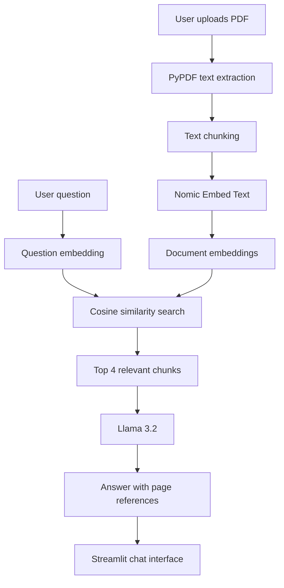

# AI Document Assistant

A local AI-powered application that lets users upload PDF documents and ask questions about their contents using natural language.

Built with Python, Streamlit, LangChain, Ollama, Llama 3.2, and Nomic Embed Text, this project demonstrates Retrieval-Augmented Generation (RAG) without requiring paid LLM API calls.

## Features

- **PDF Upload:** Upload a PDF and extract its selectable text.
- **Document Processing:** Split extracted text into smaller, overlapping chunks.
- **Semantic Search:** Generate local embeddings to identify passages relevant to a question.
- **AI Question Answering:** Use Llama 3.2 to answer questions using retrieved document passages.
- **Page References:** Include relevant page numbers in answers.
- **Missing-Information Handling:** Instruct the model to say when an answer cannot be found in the supplied context.
- **Interactive Interface:** Ask questions through a Streamlit chat interface.
- **Local Processing:** Run the language model and embedding model locally through Ollama, avoiding paid API calls.

## Technology Stack

| Technology | Purpose |
|---|---|
| Python | Application logic |
| Streamlit | Web interface |
| PyPDF | PDF text extraction |
| LangChain Text Splitters | Document chunking |
| LangChain Ollama | Integration with local AI models |
| Llama 3.2 | Answer generation |
| Nomic Embed Text | Text embeddings for semantic retrieval |
| NumPy | Cosine similarity calculations |
| Git and GitHub | Version control and project sharing |

## Architecture

The application follows a Retrieval-Augmented Generation (RAG) workflow.

1. The user uploads a PDF.
2. PyPDF extracts the text from each page.
3. The text splitter creates smaller, overlapping chunks.
4. Nomic Embed Text converts the chunks into numerical embeddings.
5. The user's question is embedded using the same model.
6. NumPy cosine similarity ranks the document chunks by relevance.
7. The application selects the top four chunks and supplies them to Llama 3.2.
8. The model generates an answer using the retrieved context and is instructed to cite relevant page numbers.

## Architecture Diagram



## Prerequisites

- Python 3.10 or later
- Git
- Ollama for running local AI models
- Sufficient RAM and disk space for the selected models

## Installation and Setup

### 1. Clone the repository

```bash
git clone https://github.com/YOUR-USERNAME/AI-Document-Assistant.git
cd AI-Document-Assistant
```

Replace `YOUR-USERNAME` with your GitHub username after creating the repository.

### 2. Create a virtual environment

Windows:

```powershell
py -m venv .venv
```

Activate it in PowerShell:

```powershell
.\.venv\Scripts\Activate.ps1
```

If PowerShell blocks activation, you can run the project's Python executable directly instead.

### 3. Install dependencies

```bash
python -m pip install -r requirements.txt
```

### 4. Install Ollama and download the models

Install Ollama from:

https://ollama.com/download

Download the models:

```bash
ollama pull llama3.2
ollama pull nomic-embed-text
```

Make sure Ollama is running locally before launching the application.

### 5. Run the application

```bash
python -m streamlit run app.py
```

Open the local URL shown in your terminal, usually:

http://localhost:8501

Upload a PDF, wait for document processing to finish, and ask questions about its content.

## Configuration

The current application uses:

- Chat model: `llama3.2`
- Embedding model: `nomic-embed-text`
- Chunk size: 800 characters
- Chunk overlap: 120 characters
- Retrieved chunks per question: 4

These settings are defined in `app.py`.

## Limitations

- Text extraction works with PDFs that contain selectable text; scanned documents may require OCR.
- Answer quality depends on PDF quality, retrieval relevance, and model performance.
- Page references identify the source pages retrieved by the application; answers should still be checked against the original document.
- Local inference performance depends on the computer's hardware.
- The application is designed for local use and has not been deployed as a public service.

## Future Improvements

- Add support for multiple PDF documents.
- Improve retrieval with a dedicated vector database.
- Add source excerpts and clickable page references.
- Add chat history management and a clear-chat option.
- Add automated evaluation of answer relevance and factual grounding.
- Improve the interface and add document-processing status indicators.

## Privacy and Security

The language model and embedding model run locally through Ollama. Uploaded documents and questions are processed by the local application and models in the standard configuration.

This project does not require an OpenAI API key. Avoid committing private documents, credentials, virtual environments, or other sensitive files to GitHub.

## Author

**Mohith Sai Gundlapalli**

AI and Data Science | Python | Data Analytics | Generative AI
